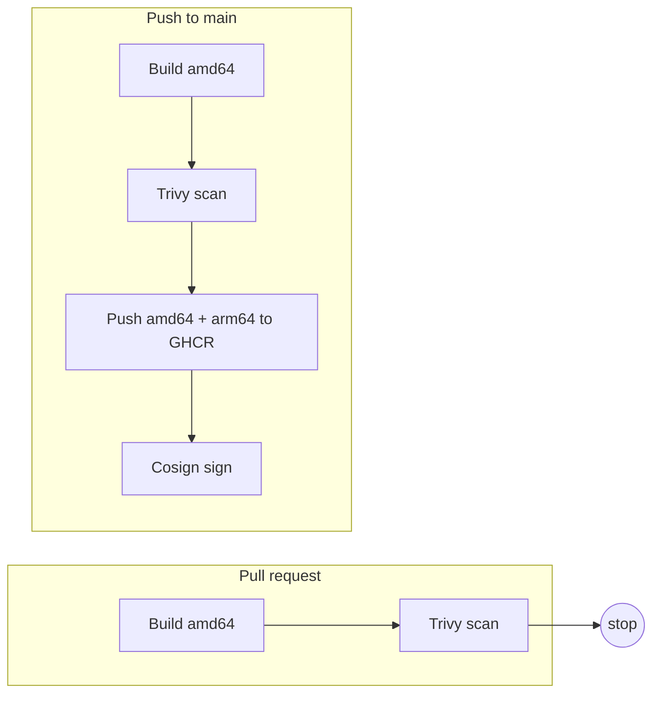

# GitHub Actions image pipeline

Unscanned images reach production because nothing checks them before they are pushed. Unsigned images cannot be traced back to the pipeline that built them. Pipelines that push from every branch leak images that nobody reviewed.

This repo builds a small container image, scans it, and on `main` pushes it to GHCR and signs it. Each gate is its own step in [image.yml](.github/workflows/image.yml).

## Flow



The scan fails on HIGH or CRITICAL findings that have a fix available.

## Verify a signed image

Replace `OWNER/REPO` with this repository.

```sh
cosign verify \
  --certificate-oidc-issuer https://token.actions.githubusercontent.com \
  --certificate-identity "https://github.com/OWNER/REPO/.github/workflows/image.yml@refs/heads/main" \
  ghcr.io/OWNER/REPO:latest
```

## Limits

- The arm64 image is not scanned, only amd64.
- Trivy's database is fetched at run time.
- The pushed image is rebuilt on main (layers come from the build cache), not the exact image that was scanned.
- No SBOM, no provenance attestation beyond what Cosign signs.
- Pushing only on main is enforced by the workflow's `if`, not by branch protection rules. Set branch protection on main yourself.

## Checks

```sh
bash test/README-check.sh   # workflow still has the scan, main-only push and cosign sign
```

## Status

Tested with actionlint, hadolint and a local amd64 build only. Not yet run in GitHub Actions.
